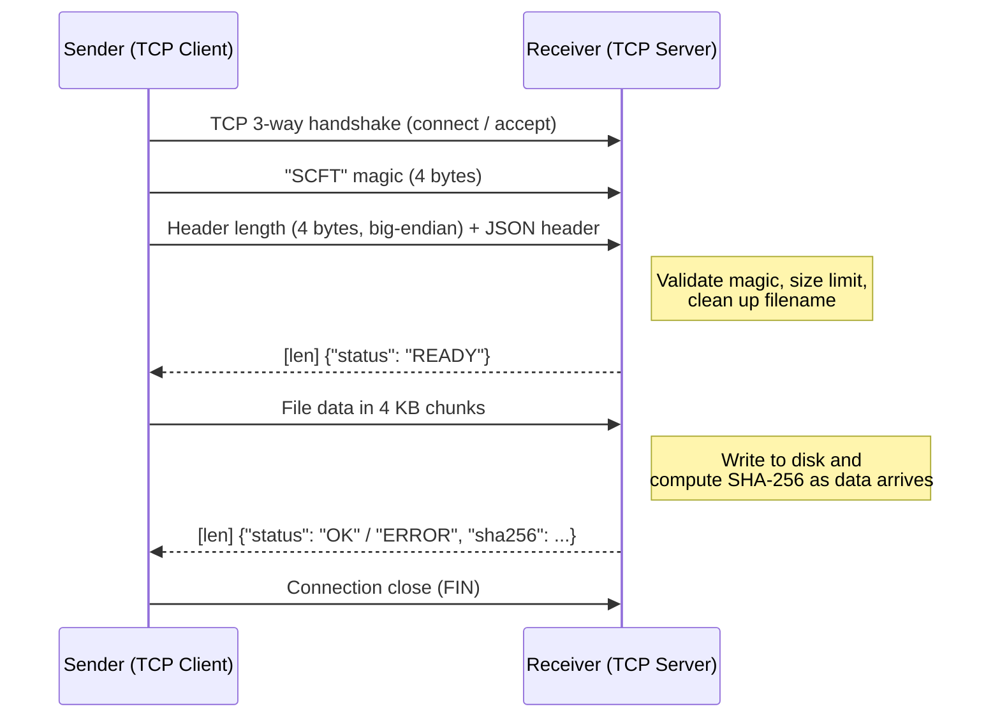

# 🔐 SafeCipher 2.0: Advanced File Security Suite

SafeCipher 2.0 is a Flask web app for **encrypting, hiding and securely sharing files**.
It combines AES-256 encryption, password-based key derivation, LSB image steganography, time-locked files and **file transfer over raw TCP sockets**, all behind a login with role-based access and audit logging.

> Built as a Computer Networks & Security (CNS) course project.

---

## ✨ Features

| Area | What it does |
|---|---|
| **File encryption** | AES-256-CBC with a key derived from your password using PBKDF2 (200,000 iterations, random 16-byte salt). |
| **Integrity check** | A SHA-256 hash of every original file is stored with it. |
| **Steganography** | Hides the encrypted file inside the least significant bits (LSB) of a cover image's pixels. The output is a normal-looking PNG. |
| **Time-lock** | Optional "unlock time". The file cannot be decrypted before that date and time (entered in IST, stored as UTC). |
| **Text encryption** | Encrypts or decrypts short text and exports it as a portable `SALT / IV / DATA` text block. |
| **Decrypt uploaded file** | Decrypts files from anywhere: AES binary, encrypted `.txt`, or stego PNG. |
| **My Vault** | Lists your encrypted files with download, decrypt and delete actions. |
| **Recycle bin** | Keeps a backup copy of each original before it is encrypted. |
| **🌐 TCP file transfer** | Sends encrypted vault files to another machine over **raw TCP sockets** using a custom protocol, with SHA-256 checked on both ends. |
| **Authentication** | Register and log in. Passwords are hashed with Werkzeug. An account locks for 5 minutes after 5 failed login attempts. |
| **Admin panel** | Lets an admin view all users, reset passwords and see the latest 50 audit log events. |

---

## 🛠 Tech Stack

- **Backend:** Python 3, Flask, Flask-Login, Flask-SQLAlchemy (SQLite)
- **Cryptography:** PyCryptodome (AES, PBKDF2), `hashlib` (SHA-256)
- **Steganography:** Pillow (LSB embedding)
- **Networking:** Python `socket` + `threading` (TCP client/server)
- **Frontend:** Jinja2 templates, HTML/CSS, vanilla JS

---

## 📁 Project Structure

```
SafeCipher_2.0/
├── app.py                  # App factory, blueprint registration, creates DB and admin user
├── config.py               # Folders, secret key, upload limit, lockout settings
├── extensions.py           # SQLAlchemy and LoginManager instances
├── models.py               # User, EncryptedFile, Log, RecycleBin
├── auth.py                 # Audit logging, lockout, OTP helpers
├── crypto_utils.py         # AES-256-CBC, PBKDF2, SHA-256, time-lock
├── stego_utils.py          # LSB hide/extract with a 32-bit length prefix
├── tcp_transfer.py         # TCP socket file transfer: protocol, server, client, CLI
├── routes/
│   ├── auth_routes.py      # /auth      login, register, logout
│   ├── main_routes.py      # /          home, dashboard
│   ├── file_routes.py      # /files     encrypt, vault, decrypt, recycle bin
│   ├── text_routes.py      # /text      text encrypt/decrypt
│   ├── admin_routes.py     # /admin     admin panel
│   └── transfer_routes.py  # /transfer  TCP transfer web UI
├── templates/              # Jinja2 HTML pages
├── static/                 # CSS and JS
├── uploads/                # Temporary uploads and decrypted outputs
├── encrypted_files/        # Encrypted files and stego images (the vault)
├── recycle_bin/            # Backups of original files
├── received_files/         # Files received over TCP
├── instance/safecipher.db  # SQLite database (created on first run)
├── requirements.txt        # Pinned dependencies
├── Dockerfile              # Container image (gunicorn)
├── docker-compose.yml      # One-command deploy with persistent volumes
└── Procfile                # Start command for Render / Railway / Heroku
```

> The data folders, the database and `venv/` are listed in `.gitignore`, so user files and accounts are never committed.

---

## 🚀 Getting Started

### 1. Prerequisites
- Python **3.10+**
- `pip`

### 2. Create a virtual environment

```bash
git clone <your-repo-url> safecipher
cd safecipher
python -m venv venv

# Windows
venv\Scripts\activate
# macOS / Linux
source venv/bin/activate
```

### 3. Install dependencies

```bash
pip install -r requirements.txt
```

### 4. Run the app

```bash
python app.py
```

Then open **http://127.0.0.1:5000**.

> ⚠️ **Run the app from inside the project folder (where `app.py` is).** File paths are relative to the current folder, so running it from anywhere else breaks downloads.

### 5. Default admin account

| Username | Password |
|---|---|
| `admin` | `admin123` |

The account is created automatically on first run. **Change this password before any real use.**

---

## ☁️ Deployment

### Option A: Docker (recommended, any OS or server)

```bash
docker compose up -d --build
```

Then open **http://localhost:5000** (or `http://<server-ip>:5000`).

- The app runs with **gunicorn** and exposes port `5000` (web) and port `5001` (TCP receiver).
- The database and all files are stored in Docker volumes, so they survive restarts and rebuilds.
- Set a real secret key with `SECRET_KEY=some-long-random-string docker compose up -d --build`.
- Stop it with `docker compose down`.

> **TCP transfer in Docker:** the receiver card shows the container's internal IP. Senders should use the **host machine's** IP with port `5001` instead.

### Option B: Render / Railway / Heroku (free hosting)

1. Push the repo to GitHub.
2. Create a new **Web Service** from the repo. The `Dockerfile` or `Procfile` is detected automatically.
   - If asked for a start command: `gunicorn --workers 1 --threads 8 --timeout 120 --bind 0.0.0.0:$PORT app:app`
3. Add an environment variable `SECRET_KEY` with a long random value.

> ⚠️ On free cloud hosting, **the disk is usually wiped on every restart or redeploy**, so the SQLite database and files are lost. The **TCP transfer receiver also won't work there**, because these platforms only allow HTTP traffic. For the TCP demo, use the local setup or Docker on a LAN or VM.

### Option C: Linux VPS (no Docker)

```bash
git clone <your-repo-url> safecipher && cd safecipher
python3 -m venv venv && source venv/bin/activate
pip install -r requirements.txt
SECRET_KEY=change-me gunicorn --workers 1 --threads 8 --bind 0.0.0.0:5000 app:app
```

> Always use `--workers 1`. The TCP receiver and its state live inside one process, and SQLite works best with a single writer. Threads handle concurrent requests.

---

## 📖 How to Use

### Encrypt a file
1. Go to **Encrypt File** and choose a file and a password.
2. *(Optional)* Tick **Steganography Mode** and upload a cover image to hide the encrypted data inside it.
3. *(Optional)* Set an **Unlock Time** to time-lock the file.
4. The encrypted file appears in **My Vault**.

### Decrypt a file
- **From the vault:** go to My Vault, click **Decrypt** and enter the password.
- **From a file on disk:** go to **Decrypt Uploaded File**, choose the file type (AES binary, TXT or PNG stego), upload it and enter the password.

### Encrypt text
Go to **Encrypt Text**, enter text and a password, then copy or download the `SALT / IV / DATA` block. Decrypt it later on the Text Decrypt page or as a TXT file.

---

## 🌐 TCP File Transfer (Networking Module)

This module sends files from one SafeCipher machine to another using **plain TCP sockets** (`socket.SOCK_STREAM`) with no HTTP involved. Only **already-encrypted** data goes over the network, so anyone capturing the traffic sees only ciphertext.

### Demo between two machines on the same network

| Step | Machine B (receiver) | Machine A (sender) |
|---|---|---|
| 1 | Open **TCP Transfer** and click **Start Receiver** (port `5001`). Note the IP shown. | |
| 2 | | Encrypt a file, then open **TCP Transfer**. |
| 3 | | Pick the file, enter B's IP and port, and click **Send over TCP**. |
| 4 | Click **Refresh**. The file shows **✅ Verified**. | Sees *"File received and SHA-256 verified"*. |
| 5 | Click **Import to Vault**, then **Decrypt** in My Vault using the sender's password. | |

To try it on a single machine, use `127.0.0.1` as the receiver IP.
The **Socket Activity Log** on the page shows each connection being accepted, the bytes received and the hash result.

### Command-line demo (no web app needed)

```bash
# Terminal 1: start a TCP server
python tcp_transfer.py receive --port 5001 --out received_files

# Terminal 2: send a file as a TCP client
python tcp_transfer.py send "encrypted_files/<some_file>" 127.0.0.1 --port 5001
```

Sample output:

```
[*] Connecting to 127.0.0.1:5001 ...
[*] Sent 1400/1400 bytes (100%)
[*] Receiver status : OK
[*] Message         : File received and SHA-256 verified
[*] Sender SHA-256  : fa34ed69382c2533...
[*] Receiver SHA-256: fa34ed69382c2533...
```

### Protocol: SCFT (SafeCipher File Transfer)

TCP delivers a continuous **stream of bytes** with no message boundaries, and one `recv()` call can return any number of bytes. SCFT therefore marks where each message ends with a **length prefix** and keeps reading until exactly the expected number of bytes has arrived.



**Header example:**

```json
{
  "filename": "encrypted_20251124_report.txt",
  "size": 1400,
  "sha256": "fa34ed69382c2533...",
  "meta": {
    "original_filename": "report.txt",
    "algorithm": "AES-256-CBC",
    "is_stego": false,
    "hash_sha256": "<hash of the original plaintext>",
    "unlock_time": null,
    "sent_by": "alice"
  }
}
```

The `meta` block lets the receiver import the file into its own vault with the correct details.

### Networking concepts demonstrated

- TCP client/server sockets: `socket()`, `bind()`, `listen()`, `accept()`, `connect()`, `sendall()`, `recv()`
- A **multi-threaded server**: each client connection runs in its own thread
- **Message framing** over a byte stream, using a length prefix
- **Chunked streaming** of large files (4 KB buffers)
- **End-to-end integrity**: SHA-256 is computed by the sender and recomputed by the receiver as data arrives
- **Defensive server design**: magic-number check, 100 MB size limit, socket timeouts, path-traversal protection, cleanup of partial files

---

## 🔒 Security Design

### Encrypted file format

```
┌───────────┬───────────┬──────────────────────┬─────────────────────────┐
│ Salt (16B)│  IV (16B) │ Unlock time (8B, UTC)│ AES-256-CBC ciphertext  │
└───────────┴───────────┴──────────────────────┴─────────────────────────┘
```

- **Key** = `PBKDF2(password, salt, 32 bytes, 200,000 iterations)`. The key is never stored.
- **Unlock time** `0` means no time-lock.
- Ciphertext uses PKCS#7 padding.

### Steganography format
The encrypted file above is prefixed with a **32-bit length** and written bit by bit into the least significant bit of each pixel's R, G and B values. Each pixel holds 3 bits, so a cover image of *W × H* pixels can carry about `(W·H·3)/8 − 4` bytes. The output is always saved as **PNG**, because lossy JPEG compression would destroy the hidden bits.

### Account security
- Passwords are stored as salted hashes (Werkzeug).
- An account locks for 5 minutes after 5 failed login attempts (set in `config.py`).
- Logins, failed logins, registrations and TCP send/receive/import actions are recorded in the `Log` table.

---

## ⚙️ Configuration

Edit `config.py` or set environment variables:

| Setting | Default | Notes |
|---|---|---|
| `SECRET_KEY` | `your-secret-key-here` | **Set a real value** with the `SECRET_KEY` env variable. |
| `DATABASE_URL` | `sqlite:///safecipher.db` | Any SQLAlchemy URL. |
| `MAX_CONTENT_LENGTH` | 16 MB | Maximum upload size. |
| `LOCKOUT_THRESHOLD` | 5 | Failed logins allowed before lockout. |
| `LOCKOUT_TIME` | 300 s | How long the lockout lasts. |
| `RECEIVED_FOLDER` | `received_files` | Optional. Where files received over TCP are saved. |

---

## 🧯 Troubleshooting

| Problem | Fix |
|---|---|
| `ModuleNotFoundError: No module named 'Crypto'` | Run `pip install -r requirements.txt` inside the activated venv. |
| `Fatal error in launcher` / `did not find executable at ...` | The venv was copied from another computer. Delete `venv/` and create a new one (see Getting Started). |
| PowerShell: *running scripts is disabled* when activating the venv | Run `Set-ExecutionPolicy -Scope CurrentUser RemoteSigned` once. |
| Sending fails between two laptops | On the sender, run `Test-NetConnection <receiver-ip> -Port 5001`. If it fails, the network is blocking it: use a phone hotspot (college Wi-Fi often blocks device-to-device traffic) and allow Python in the receiver's firewall. |
| Sender gets *connection refused / timed out* | Check that the receiver is started, both machines are on the same network and the IP and port are correct. |
| The other machine can't connect, but `127.0.0.1` works | **Allow Python through Windows Firewall** (Windows asks the first time the receiver starts) or open the port manually. |
| *Could not start receiver on port …* | The port is already in use. Pick another one, such as `5002`. |
| A download returns a 500 error / file not found | Start the app from inside the project folder (where `app.py` is). |
| *File is locked until …* | The file is time-locked. Wait until the unlock time shown. |

---

## ⚠️ Limitations

This is an academic project and is **not production-hardened**:

- The admin password and `SECRET_KEY` defaults are hard-coded, so change them.
- Any logged-in user can see the TCP *Received Files* list.
- TCP transfers are not authenticated, so anyone who can reach the port can send a file. The data itself is still encrypted and hash-checked.
- AES-CBC gives confidentiality but no built-in authentication. AES-GCM or encrypt-then-MAC would be a stronger choice.
- Flask's built-in server is for development only.

---

## 📄 License

Created for educational purposes as part of a university CNS course project.
